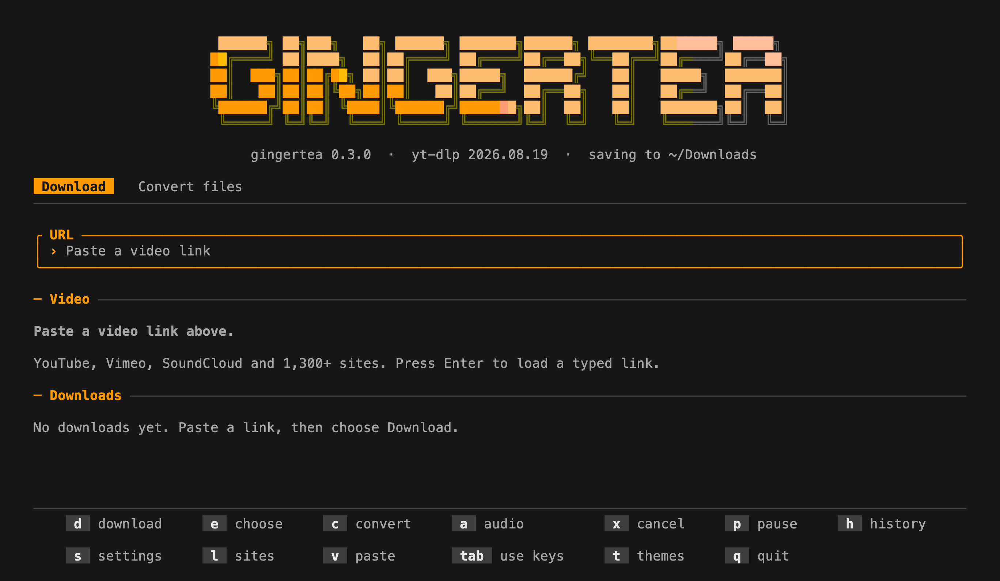

<div align="center">

<pre>
 ██████╗ ██╗███╗   ██╗ ██████╗ ███████╗██████╗ ████████╗███████╗ █████╗
██╔════╝ ██║████╗  ██║██╔════╝ ██╔════╝██╔══██╗╚══██╔══╝██╔════╝██╔══██╗
██║  ███╗██║██╔██╗ ██║██║  ███╗█████╗  ██████╔╝   ██║   █████╗  ███████║
██║   ██║██║██║╚██╗██║██║   ██║██╔══╝  ██╔══██╗   ██║   ██╔══╝  ██╔══██║
╚██████╔╝██║██║ ╚████║╚██████╔╝███████╗██║  ██║   ██║   ███████╗██║  ██║
 ╚═════╝ ╚═╝╚═╝  ╚═══╝ ╚═════╝ ╚══════╝╚═╝  ╚═╝   ╚═╝   ╚══════╝╚═╝  ╚═╝
</pre>

Download and convert media in your terminal.

Rust · Ratatui · yt-dlp · FFmpeg

[Install](#install) · [Usage](#usage) · [Controls](#controls) · [Development](docs/development.md) · [Releases](https://github.com/orbitcord/gingertea/releases)



</div>

## What you can do

- Download videos, audio, and playlists. Pick individual items or the first N.
- Convert local video, audio, and images. Trim clips or export frames.
- Manage the queue, browse history, and preview tea themes.

## Install

```sh
uv tool install gingertea
gingertea setup
gingertea
```

Prefer pipx? Run `pipx install gingertea`, then the same setup command.

Native wheels support Linux x86-64, Windows x86-64, and Apple Silicon and Intel
Macs. The package manager requires Python 3.10+. The app runs as a native Rust
executable. Standalone binaries are on [GitHub Releases](https://github.com/orbitcord/gingertea/releases).

`setup` finds or downloads yt-dlp, FFmpeg/FFprobe, and Deno.
See [media tools](docs/usage.md#media-tools) for optional image codecs.

<details>
<summary>Updating an existing install</summary>

```sh
uv tool upgrade gingertea
# Or: pipx upgrade gingertea
gingertea setup
```

Settings, history, and playlist archives carry over from the Python app.
For standalone installs, replace the executable with the latest release.
`gingertea update` updates yt-dlp only.

</details>

## Usage

```sh
gingertea                              # open the terminal app
gingertea URL                          # load a video or playlist
gingertea /path/to/file                 # load local media
gingertea get URL -f mp4                # download a video
gingertea get URL --audio -f mp3 -q 192  # download audio
gingertea convert file.mov -f mp4       # convert a local file
```

Conversions preserve originals. Existing output names get numbered suffixes.
See [clips, frames, and metadata](docs/usage.md#command-line) for more commands.

## Controls

Press **Tab** to leave the input and use shortcuts. **Esc** returns to the input.

| Key | Action |
| --- | --- |
| `1` / `2` | Download / Convert files |
| `d` / `a` | Download video / audio |
| `c` / `e` | Conversion options / playlist selection |
| `p` / `x` | Pause waiting jobs / cancel a job |
| `h` / `f` | History / files |
| `s` / `t` | Settings / themes |
| `q` | Quit |

Tabs, buttons, and options also accept clicks.
See [all controls and settings](docs/usage.md#terminal-controls).

## Build from source

Requires Rust 1.88 or later.

```sh
cargo install --path . --locked
gingertea setup
gingertea
```

[Development and checks](docs/development.md) · [0.3.0 release notes](docs/releases/0.3.0.md) · [MIT license](LICENSE)
